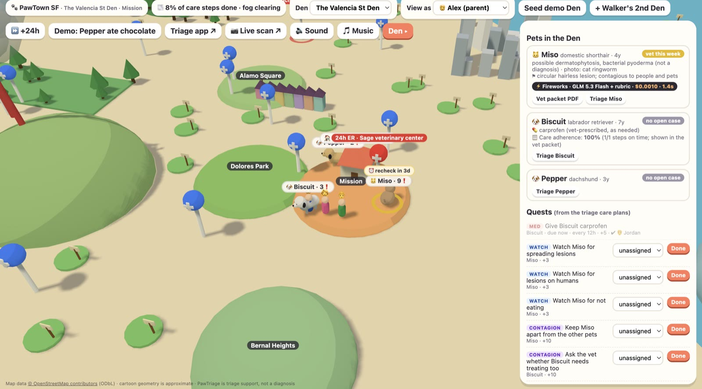
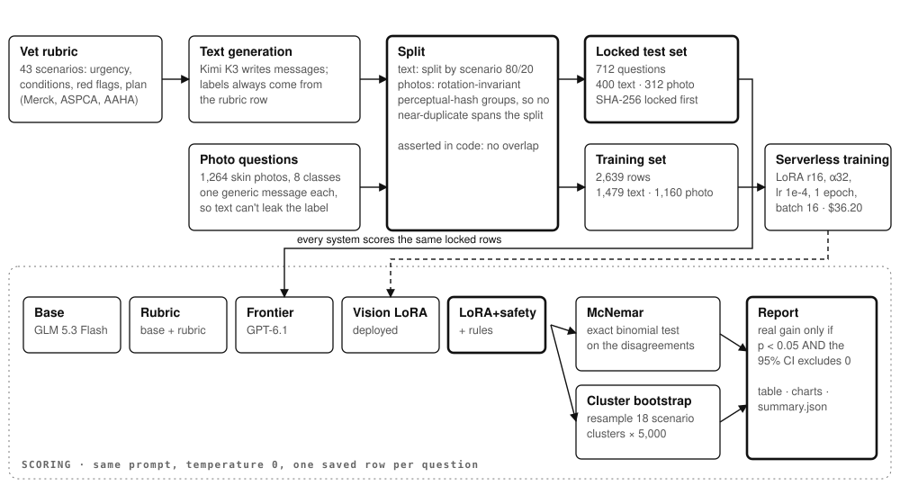
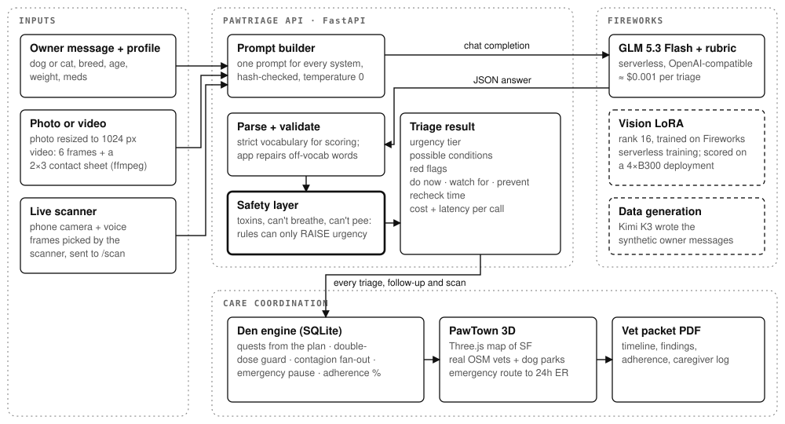
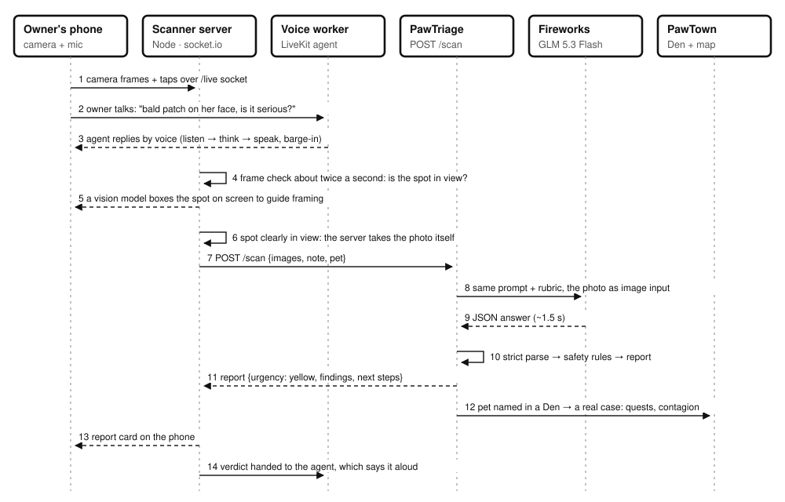
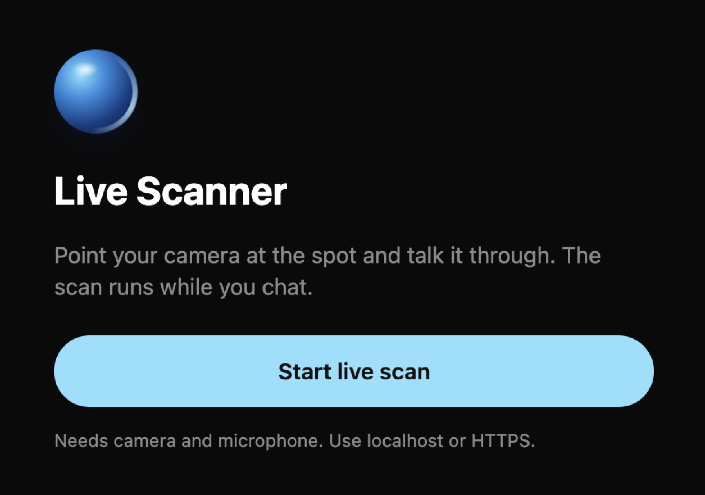
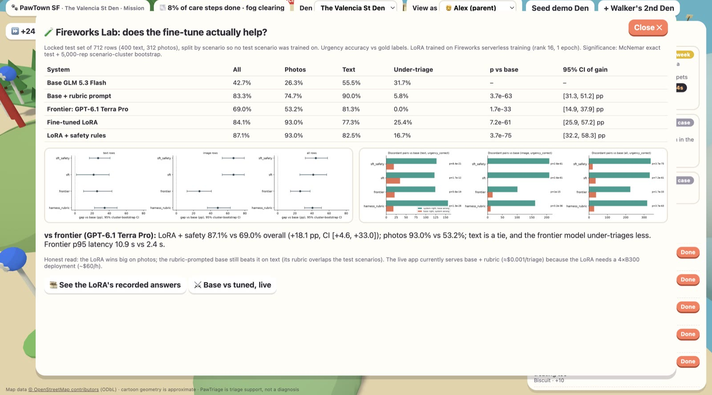
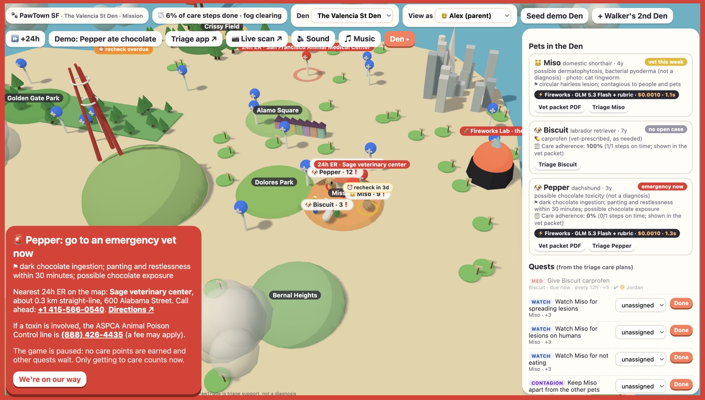
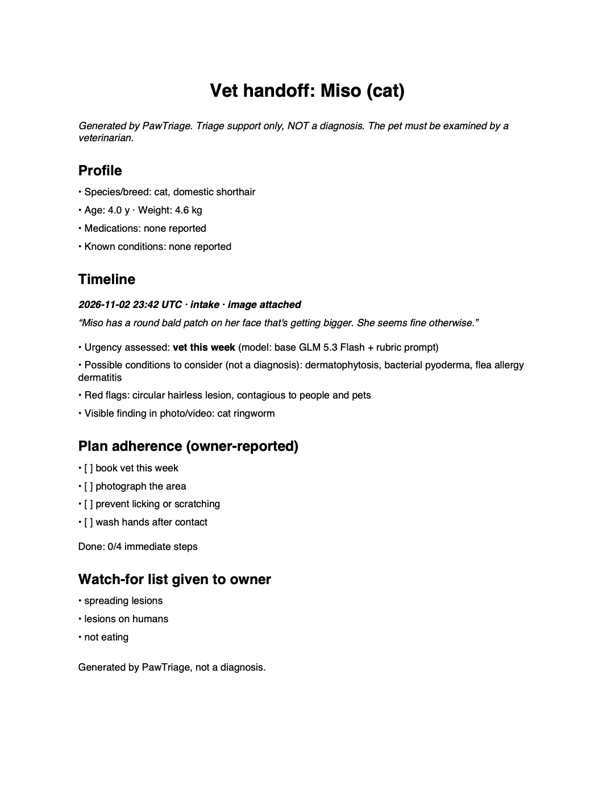

<div align="center">

# 🐾 PawTriage

### A vision fine-tune of GLM 5.3 Flash that tells pet owners when "watch it" becomes "go now", wired into PawTown SF: a 3D game where a whole household shares the care.

**Fireworks AI · "Make your own frontier" hackathon · San Francisco · Nov 2, 2026**

`87.1%` urgency accuracy vs `42.7%` base · `93.0%` on photos vs `26.3%` · beats a frontier model `87.1%` vs `69.0%` · about `$0.001` per live triage



</div>

---

## Contents
1. [The hackathon theme and how we answered it](#1-the-hackathon-theme-make-your-own-frontier)
2. [The problem](#2-the-problem)
3. [Headline results](#3-headline-results)
4. [How the fine-tuning works](#4-how-the-fine-tuning-works)
5. [How we know it's real: the evaluation](#5-how-we-know-its-real-the-evaluation)
6. [System architecture](#6-system-architecture)
7. [Live scan: camera + voice → fine-tuned triage](#7-live-scan-camera--voice--triage)
8. [PawTown SF: care as a game](#8-pawtown-sf-care-as-a-game)
9. [Outputs: report, emergency mode, vet packet](#9-outputs)
10. [Run it yourself](#10-run-it-yourself)
11. [Cost](#11-cost)
12. [Caveats and disclosure](#12-caveats-and-disclosure)

---

## 1. The hackathon theme: "Make your own frontier"

The challenge: **take an open model, fine-tune it on Fireworks, and show with benchmark rigor that it beats the base, and ideally a closed frontier model, on a task that matters.** Judging weighted the benchmark most heavily (40), then the business case (25), the technical build (20), presentation (10) and docs (5).

How we hit each part:

| Theme requirement | What PawTriage does |
|---|---|
| **Open model** | GLM 5.3 Flash (open weights), served on Fireworks |
| **Fine-tune on Fireworks** | Vision LoRA trained with **Fireworks serverless training** (cookbook `sft_loop`, `glm53_flash` multimodal renderer), deployed on a Fireworks dedicated deployment and scored through that endpoint |
| **Beat the base** | 87.1% vs 42.7% urgency accuracy; photos 93.0% vs 26.3% (McNemar p ≈ 3e-61) |
| **Beat the frontier** | 87.1% vs 69.0% against GPT-6.1 Terra Pro on the same 712 rows, at under half the cost and ~5× lower latency |
| **Benchmark rigor** | Locked test set split by scenario and by image near-duplicate group; identical prompt for every system (hash-asserted); McNemar exact test **and** 5,000-rep cluster bootstrap; a gain counts only if both agree |
| **Business case** | Measured $/1k chats per system; named buyers (after-hours vet lines, telehealth, pet insurers, dog-walker businesses) |
| **A product people use** | FastAPI app, a live camera + voice scanner, and PawTown SF, a 3D shared-care game |

---

## 2. The problem

San Francisco has more dogs than children. Most pets have **several caregivers**: partners, roommates, a dog walker. Two things go wrong:

1. **Nobody knows when "watch it" becomes "go now".** Owners search symptoms, get generic answers, and either panic or wait too long. Waiting too long (*under-triage*) is the expensive, dangerous mistake: xylitol, chocolate, a blocked cat.
2. **Care falls between the cracks.** Who gave the 8 am carprofen? Did anyone recheck the eye? Ringworm on the cat means *every* pet and person in the house needs steps, and nobody coordinates that.

General LLMs are slow and costly at scale, and they're surprisingly bad at reading a photo of skin. Clinics also want the model and the photos in their own account. **That's the gap for a small, cheap, specialised open model.**

**What PawTriage does:** an owner describes the problem (optionally with a photo or short video). PawTriage returns an urgency tier (`emergency_now` / `vet_today` / `vet_this_week` / `monitor_at_home`), likely conditions (*possible, never a diagnosis*), red flags, a protection plan and a recheck time. PawTown turns that plan into shared quests for the whole household.

---

## 3. Headline results

**Locked test set: 712 questions** (400 text from 10 held-out scenarios, 312 photo questions from 104 held-out images).

| System | All rows | Photos | Text | Text under-triage ↓ | $ / 1k chats | p95 latency |
|---|---|---|---|---|---|---|
| Base GLM 5.3 Flash | 42.7% | 26.3% | 55.5% | 31.7% | $0.33 | 2.3 s |
| Base + rubric in prompt | 83.3% | 74.7% | **90.0%** | **5.8%** | $1.02 | 3.3 s |
| Frontier: GPT-6.1 Terra Pro | 69.0% | 53.2% | 81.2% | 0.0% | $4.17 billed | 10.9 s |
| **Vision LoRA (ours)** | 84.1% | **93.0%** | 77.2% | 25.4% | $1.81 | 2.4 s |
| **Vision LoRA + safety layer (ours)** | **87.1%** | **93.0%** | 82.5% | 16.7% | $1.81 | 2.4 s |

**Fine-tune + safety vs frontier, head to head** (`results/vs_frontier.json`):

| Slice | Gap | 95% cluster-bootstrap CI | McNemar (wins vs losses) | Verdict |
|---|---|---|---|---|
| All rows | **+18.1 pp** | [+4.6, +33.0] | 180 vs 51, p = 4.6e-18 | real gain |
| Photos | **+39.7 pp** | [+20.2, +59.6] | — | real gain |
| Text | +1.2 pp | [−10.8, +12.5] | — | tie |

**Fine-tune + safety vs base:** all rows 336 discordant wins vs 20 losses (p = 3.7e-75); photos 209 vs 1.

The honest picture: **the fine-tune's big win is photos.** On text, the rubric-in-prompt harness is still best, and the frontier model under-triages least (it over-calls urgency instead). Full per-slice tables are in [§5](#5-how-we-know-its-real-the-evaluation).

---

## 4. How the fine-tuning works



### 4.1 Rubric first, then data
Everything starts from a **vet-reference rubric** (`data/rubric.csv`): 35 scenarios drafted from Merck Vet Manual, ASPCA Animal Poison Control and AAHA references. Each row fixes the ground truth: urgency tier, body system, likely conditions, red flags, the immediate / watch-for / prevent plan, a never-do list and the recheck window. **Labels always come from the rubric row, never from a model.**

### 4.2 Text rows: synthetic owner messages
**Kimi K3** (on Fireworks) writes realistic owner messages for each scenario: different voices, levels of panic, typos, pet profiles. Then:
- validate every row against the rubric's vocabulary (`src/pt_data.py`);
- dedupe near-copies (Jaccard > 0.8);
- **split by scenario, 80/20**, so no test scenario is ever seen in training (asserted in code), stratified so the test set has every urgency tier and both species.

Result: 1,879 text rows. Generation cost **$3.56**.

### 4.3 Image rows: real skin photos
1,264 skin photos in **8 classes**: cat ringworm / flea allergy / scabies-mange / healthy; dog allergic / bacterial / fungal dermatosis / healthy. Two details keep this honest:
- **One generic owner message for every photo** ("is this spot serious?"), so the text can't leak the label. The model has to read the image.
- **Split by near-duplicate group.** The cat set contains rotated and flipped copies, so images are grouped by a **dihedral-invariant dHash** before splitting: no near-duplicate pair spans train and test.

Train has 1 message per image; test has 3 per image (312 rows from 104 images).

### 4.4 One prompt, one schema, everywhere
`src/pt_prompt.py` holds the single system prompt, JSON schema and parser used by **training, every evaluated system, and the app**. The prompt hash is asserted at scoring time, so no system gets a better prompt than another. Every field is a closed vocabulary (`data/vocab/`), so the scorer can check each one exactly. A real training target for a cat ringworm photo:

```json
{
  "urgency": "vet_this_week",
  "system": "skin",
  "conditions": [
    "dermatophytosis",
    "flea_allergy_dermatitis",
    "bacterial_pyoderma"
  ],
  "red_flags": [
    "circular hairless lesion",
    "contagious to people and pets"
  ],
  "plan": {
    "immediate": [
      "book_vet_this_week",
      "isolate_from_other_pets",
      "wash_hands_after_contact",
      "photograph_the_area"
    ],
    "watch_for": [
      "spreading_lesions",
      "lesions_on_humans"
    ],
    "prevent": [
      "treat_all_pets_in_household"
    ],
    "recheck": "72h"
  },
  "image_finding": "cat_ringworm"
}
```

### 4.5 Training on Fireworks serverless
- **Recipe:** the official Fireworks cookbook `recipes/sft_loop.py` with `serverless=True`. It owns the GLM 5.3 Flash multimodal renderer (`glm53_flash`), datum construction, checkpointing and promotion. One image row renders to an `ImageChunk` (529 tokens) plus text, about 1,950 tokens in total.
- **Training set:** `data/splits/sft_train.jsonl`, **2,639 rows** (text + image, about 60/40).
- **Hyperparameters:**

| Setting | Value |
|---|---|
| Base model | `accounts/fireworks/models/glm-5p3-flash` |
| Method | LoRA, rank 16, alpha 32 |
| Learning rate | 1e-4 |
| Epochs | 1 |
| Batch size | 16 |
| Training shape | `glm-5p3-flash-262k-b300-lora` |
| Train tokens | 4.07 M |
| **Cost** | **$36.20** (4.07 M × $8.89 / M) |
| Wall time | ~1–1.5 h |

- **Real-world friction:** serverless training returned `409 capacity_exhausted` for ~8 minutes, so `scripts/train_retry.py` relaunched every ~70 s and cleaned up orphan sessions (DECISIONS.md #22).

### 4.6 Serving and scoring the LoRA
Fireworks can't serve a GLM 5.3 Flash LoRA serverless, so the adapter went on a **dedicated 4×B300 deployment** (~$60/h). All 712 test rows were scored **through that endpoint**, and every answer was recorded in `results/sft.jsonl`. The deployment ran for 17 minutes and was then deleted to stay inside the budget. The recorded answers power the in-app **replay** view.

### 4.7 The safety layer (`src/pt_safety.py`)
`sft_safety` is the **same LoRA answers** with deterministic rules applied: no extra model call. Toxin and emergency-phrase overrides (xylitol, chocolate, lilies in cats, "can't pee", "not breathing"…) and a never-list filter. Rules can only **raise** urgency, never lower it. A bug found during evaluation (rules skipped when the JSON failed to parse) was fixed before the final numbers; a known regex gap ("sugarfree", brand names) was deliberately **not** patched, to avoid tuning on the test set.

---

## 5. How we know it's real: the evaluation

Five systems, one locked test set, one prompt:

- `base`: GLM 5.3 Flash, temperature 0.
- `harness_rubric`: base + the full rubric in the system prompt (the strong prompt-engineering baseline).
- `frontier`: GPT-6.1 Terra Pro via OpenRouter.
- `sft`: our vision LoRA.
- `sft_safety`: the LoRA + deterministic safety rules.

**Statistics.** For each system vs base (and vs frontier) we run a **McNemar exact test** on paired per-row correctness and a **5,000-rep cluster bootstrap** that resamples whole scenarios / image groups (18 clusters), so correlated rows can't inflate significance. **A gain is "real" only if p < 0.05 *and* the 95% CI excludes zero.** The scorer is strict: an answer that fails the schema is wrong (the app salvages off-vocabulary words; the scorer never does).

#### All rows (text + image)
| system | urgency acc | under-triage | harmful advice | top-1 cond | plan recall | $/1k chats | p95 ms | McNemar p | bootstrap 95% CI (pp) | real gain |
|---|---|---|---|---|---|---|---|---|---|---|
| base | 42.7% | 31.7% | 0.0% | 45.4% | 46.6% | $0.330 | 2339 | — | — | — |
| harness_rubric | 83.3% | 5.8% | 0.0% | 75.6% | 83.7% | $1.019 | 3344 | 3.7e-63 | +40.6 [+31.3, +51.2] | yes |
| frontier | 69.0% | 0.0% | 0.0% | 77.5% | 69.9% | $9.627 | 10929 | 1.7e-33 | +26.3 [+14.9, +37.9] | yes |
| sft | 84.1% | 25.4% | 0.0% | 76.1% | 74.0% | $1.814 | 2386 | 7.2e-61 | +41.4 [+25.9, +57.2] | yes |
| sft_safety | 87.1% | 16.7% | 0.0% | 76.1% | 74.9% | $1.814 | 2386 | 3.7e-75 | +44.4 [+32.2, +58.3] | yes |

#### Text rows
| system | urgency acc | under-triage | harmful advice | top-1 cond | plan recall | $/1k chats | p95 ms | McNemar p | bootstrap 95% CI (pp) | real gain |
|---|---|---|---|---|---|---|---|---|---|---|
| base | 55.5% | 31.7% | 0.0% | 67.8% | 60.1% | $0.330 | 2339 | — | — | — |
| harness_rubric | 90.0% | 5.8% | 0.0% | 90.2% | 89.9% | $1.019 | 3344 | 1.3e-28 | +34.5 [+22.8, +49.2] | yes |
| frontier | 81.2% | 0.0% | 0.0% | 91.2% | 77.1% | $9.627 | 10929 | 5.6e-19 | +25.8 [+10.0, +43.2] | yes |
| sft | 77.2% | 25.4% | 0.0% | 72.8% | 66.1% | $1.814 | 2386 | 1.7e-12 | +21.8 [+1.8, +40.0] | yes |
| sft_safety | 82.5% | 16.7% | 0.0% | 72.8% | 67.7% | $1.814 | 2386 | 8.4e-21 | +27.0 [+16.8, +41.0] | yes |

#### Image rows
| system | urgency acc | under-triage | harmful advice | top-1 cond | plan recall | $/1k chats | p95 ms | McNemar p | bootstrap 95% CI (pp) | real gain |
|---|---|---|---|---|---|---|---|---|---|---|
| base | 26.3% | — | 0.0% | 16.7% | 29.3% | $0.330 | 2339 | — | — | — |
| harness_rubric | 74.7% | — | 0.0% | 56.7% | 75.8% | $1.019 | 3344 | 3.2e-36 | +48.4 [+36.2, +63.1] | yes |
| frontier | 53.2% | — | 0.0% | 59.9% | 60.7% | $9.627 | 10929 | 1e-15 | +26.9 [+12.5, +41.0] | yes |
| sft | 93.0% | — | 0.0% | 80.5% | 84.1% | $1.814 | 2386 | 2.6e-61 | +66.7 [+53.5, +79.5] | yes |
| sft_safety | 93.0% | — | 0.0% | 80.5% | 84.1% | $1.814 | 2386 | 2.6e-61 | +66.7 [+53.5, +79.5] | yes |

**Read this honestly:**
- **Real gains** (p < 0.05 and CI excludes 0) vs base: fine-tune and fine-tune+safety on urgency (text, image, all), top-1 condition (image, all) and image finding. Full list in `results/summary.json`.
- **On text, the rubric-in-prompt harness still beats the fine-tune** (90.0% vs 82.5% with safety; McNemar p = 0.0032 on 98 discordant pairs). Its prompt contains the full rubric, *including the rows for the held-out test scenarios*; the fine-tune never saw those scenarios. On photos the fine-tune wins (93.0% vs 74.7%).
- **Under-triage on text:** base 31.7% → fine-tune 25.4% → fine-tune + safety 16.7% (harness 5.8%). The safety-layer improvement's bootstrap CI vs base is [-22.1, -7.9] pp: only 6 high-urgency test scenarios, so it does not clear the bar. Most of the gain is xylitol (fine-tune alone 25% → 77.5% with the toxin rule).
- **Safety-layer bug found and fixed during evaluation:** rules did not fire when the model's JSON failed to parse. Fixed in `pt_safety.apply` (rules now build an emergency answer); the numbers above are post-fix. Known gap, *found by reading test failures and deliberately not patched* to avoid tuning on the test set: the xylitol regex misses "sugarfree", "candies", brand names (Orbit, Trident) and "pudding".
- Harmful advice was 0% for every system: no model emitted a never-list item, so the never-list filter is untested by this benchmark.
- **Cost:** base/harness are serverless per-token. Fireworks can't serve a LoRA serverless, so the fine-tune's $/1k is a dedicated 4×B300 ($60/h) at the throughput we measured (~33k chats/h at concurrency 16, a mostly idle GPU). It drops with utilisation or multi-LoRA sharing; it is not a like-for-like per-token number.
- **Frontier cost:** the table's $9.63/1k is computed from OpenRouter list prices ($1/$5 per M tokens) × measured tokens; OpenRouter actually billed **$2.97 for all 712 rows ≈ $4.17/1k**. Head-to-head vs frontier (all systems, McNemar + bootstrap) is in `results/vs_frontier.json`.
- **Not scored:** `sft_router` (the large router model rejected an image input; cut per the scope valve), video (no labelled clips).
- Only 10 text scenarios and 8 image classes in the test set: intervals are wide by construction.

<p align="center">
 
</p>

---

## 6. System architecture



| piece | file |
|---|---|
| One prompt + JSON schema + parser for every system, training and the app | `src/pt_prompt.py` |
| Rubric validation, generation, dedupe (Jaccard > 0.8), scenario split, test lock | `src/pt_data.py`, `src/pt_pipeline.py` |
| Scoring (urgency, under-triage, top-1 condition, set F1, plan recall, harmful advice, image finding) | `src/pt_score.py` |
| Systems: base, rubric-in-prompt harness, frontier, sft, sft+safety, sft+router | `src/pt_systems.py` |
| Vision LoRA on Fireworks serverless training (cookbook `sft_loop`, `glm53_flash` renderer) | `src/pt_sft.py` |
| McNemar, cluster bootstrap, charts, summary | `src/pt_report.py` |
| Guardrails (toxin + emergency-phrase overrides, never-list filter, review flag) + router | `src/pt_safety.py` |
| Video → 6 frames + 2×3 contact sheet (ffmpeg) | `src/pt_video.py` |
| Token/$ accounting (Fireworks list prices, dated) | `src/pt_cost.py`, `src/prices.json` |
| FastAPI + sqlite backend, single-file frontend | `app/backend/`, `app/frontend/index.html` |

---

## 7. Live scan: camera + voice → triage



PawTriage plugs into [live-scanner](https://github.com/mercadobeomelo/live-scanner), a phone camera + voice agent (LiveKit). The owner just talks: *"There's a bald patch on her face, is it serious?"*

1. The voice worker runs the conversation; the server watches frames and runs a fast framing check.
2. Gemini returns a `box_2d` around the spot and the agent asks the owner to hold steady.
3. The **server takes the photo itself** and calls `SCAN_ENGINE_URL` → PawTriage `POST /scan`.
4. PawTriage triages it (~1.5 s) and maps urgency to the scanner's red / orange / yellow / green report.
5. If the pet name matches a pet in a Den, `record_scan` saves the result as a **case on the PawTown map** within ~5 s: quests, contagion fan-out and emergency mode included.

**The voice agent and camera never change. Only the model behind `/scan` does.**

<p align="center"></p>

To run it: put LiveKit + OpenAI + Gemini keys in `server/.env`, set `SCAN_ENGINE_URL=http://localhost:8031/scan`, run `npm start` + `npm run worker:dev`, and open it through an HTTPS tunnel. Set `ACCESS_TOKEN` and open the link with `?key=<token>` (our patch to `web/src/App.tsx` reads the key from the link instead of baking it into the JS). Repeat scans refresh quests instead of duplicating them; a scan with no pet name stays stateless.

---

## 8. PawTown SF: care as a game

A household (**Den**) has several caregivers (parent, co-parent, helper/dog walker) and several pets. **Every game mechanic is a care behavior**, and the game never rewards waiting.

| Game mechanic | Health behavior it drives |
|---|---|
| Quests generated from each triage care plan | Plan adherence: "do now" steps, watch-fors, rechecks |
| Recheck timers over each pet (orange when overdue) | Following up before things worsen |
| Med quests with a **double-dose guard** | Two caregivers can't both give the 8 am carprofen; the second "Done" is blocked and logged |
| **Contagion mode**: a contagious finding (e.g. ringworm from a photo) adds quests for *every* pet in the Den, plus hand-washing if it can spread to people | Stops household spread |
| Shift-handoff notes | Become a "Caregiver log" section in the vet packet PDF |
| Helper view | Dog walkers see today's tasks only, not diagnoses or photos |
| **Emergency mode**: scene turns red, game pauses, route and phone for the nearest real 24h vet, poison-control line | Nothing is scored for waiting; the only thing to do is go |
| Care points and badges ("Went when it mattered", "Double dose caught", "Contagion contained") | Points only for care actions, never for staying home |
| Fog over SF clears as the Den finishes care steps | Visual progress |
| Neighborhood health weather | Anonymous contagion counts, hidden below 3 reports (privacy) |

**Map:** cartoon SF in Three.js (r160), neighborhood islands at real coordinates. Vets (26, 2 tagged 24h/emergency) and dog parks (39) are **real OpenStreetMap data** (© OSM contributors, ODbL); no vet is invented, and the UI says to call ahead because hours can be stale.

**Sound:** every pet and game sound is **synthesized live with Web Audio** (no audio files): meows, size-matched barks, purrs, a whimper when the double-dose guard fires, a siren and howl for emergencies, a shutter on a live scan. The background music is an original 8-bar loop at 104 bpm that **fades out when emergency mode starts**.

### The Fireworks Lab
A landmark in Mission Bay (`/pawtown#lab`) that shows the results table, McNemar p-values, bootstrap CIs and charts inside the game.



### Demo views
- `/#compare`: **base vs. tuned, live.** Same photo, two real calls in parallel, each with a ⚡ Fireworks cost and latency badge (≈$0.002 per run).
- `/#replay`: **the fine-tune's recorded answers.** For locked-test-set photos, it shows base, base + rubric, LoRA and LoRA + safety side by side against the gold label. It can show wins, random photos or misses. No GPU needed.
- `/pawtown#lab`: the **Fireworks Lab** landmark in Mission Bay, showing the results table, McNemar p-values, bootstrap CIs and charts inside the game.
- **Care adherence:** % of due care steps done on time, per pet. Shown on the pet card and in the vet packet (useful for vets and insurers).
- **Dog-walker route** (`/walker/{name}`): one helper's tasks for today across every Den they belong to.
- `POST /demo/reset`: wipes the local demo database.

---

## 9. Outputs

### Emergency mode
"Pepper ate chocolate" → a real model call plus the toxin rule → `emergency_now`. The city turns red, the game pauses, and the screen shows the route and phone number for the nearest real 24h vet plus the poison-control line.



### `/scan` response (real, ringworm cat photo, GLM 5.3 Flash, 1,465 ms)
The live scanner gets a yellow "vet within 48 h" report with the finding, possible conditions, what to do now and what to watch for.

### Vet packet PDF
A timeline of every triage, care adherence (% of due steps done on time), and the caregiver log from shift handoffs. The vet gets it before you walk in.

<p align="center"></p>

---

## 10. Run it yourself

```bash
uv venv --python 3.11 .venv && uv pip install --python .venv -r requirements.txt
cp .env.example .env   # FIREWORKS_API_KEY (+ OPENROUTER_API_KEY for the frontier row)
# training venv (Fireworks cookbook, torch/transformers pins)
git clone --depth 1 https://github.com/fw-ai/cookbook vendor/cookbook
(cd vendor/cookbook/training && UV_PROJECT_ENVIRONMENT=../../../.venv-train uv sync --python 3.11)
```

| notebook | what | cost | time |
|---|---|---|---|
| `00_rubric_check` | validate rubric + vocab, coverage | $0 | <5 s |
| `01_generate_and_split` | ~2,000 text + ~1,400 image rows; split; human review; **lock** | $3.56 actual (Kimi K3) | ~15 min |
| `02_baseline` | base GLM 5.3 Flash, temp 0 | ~$0.30 | ~3 min |
| `03_harness` | base + full rubric in the system prompt | ~$0.75 | ~4 min |
| `04_sft` | vision LoRA, serverless training | $36.20 actual (4.07M train tokens × $8.89/M); serving deployment ≈ $17 for 17 min | ~1–1.5 h |
| `05_score_all` | every system on the locked test set (cached) | ~$1 + deployment time | ~10 min |
| `06_report` | McNemar + bootstrap + charts + summary | $0 | <1 min |

App: `.venv/bin/uvicorn app.backend.main:app --port 8031` → http://localhost:8031. With no fine-tune deployed, **Best available** serves base + rubric prompt (83% on the test set); **Base** is the untuned before/after toggle.

**Deploy to Vercel:** this repo ships `vercel.json` + `api/index.py`, which serve the same FastAPI app as one Python function (all routes rewritten to `/api/index`, 60 s max duration). Set `FIREWORKS_API_KEY` in the Vercel project settings. Vercel's filesystem is read-only and ephemeral, so the PawTown demo database resets between cold starts.

**Demo state:** `curl -X POST localhost:8031/demo/reset`, then open `/pawtown` → **Seed demo Den** (one real photo triage, ≈$0.001) → **+ Walker's 2nd Den**. PawTown needs a real browser with WebGL. Full 3-minute script: [`demo/demo_script.md`](demo/demo_script.md). Design decisions: [`DECISIONS.md`](DECISIONS.md).

### Data
- **Text:** 1,879 rows from 35 rubric scenarios (`both_*` scenarios expand to dog + cat). Split **by scenario** 80/20, so no test scenario is seen in training (asserted in code); stratified so the test set has every urgency tier and both species.
- **Images (path taken: public dataset, not the Oxford-IIIT fallback):** 1,264 skin photos in 8 classes from Hugging Face `sanjayS059/Pet_disease` (dogs, MIT) and `shahida12/Russiancat-skin-disease` (cats, **no licence declared**, so hackathon use only and images are not redistributed). Classes: cat ringworm / flea allergy / scabies-mange / healthy; dog allergic / bacterial / fungal dermatosis / healthy. Owner messages for image rows use **one generic prompt for every class** ("is this spot serious?") so the text cannot leak the label.
- **Label verification:** 30-image contact sheets per class were inspected (`data/images/VERIFICATION.md`, `data/raw/verify/`). No class was dropped; 122 colour-flooded junk dog images were quarantined. **This check was done by an AI agent, not two humans.**
- **Near-duplicates:** the cat set contains rotated/flipped copies, so images are split by **dihedral-invariant dHash group**: no near-duplicate pair spans train and test.
- **Video:** frame-sampled into the image path. Human-labelled clip eval: **not yet collected**: pipeline is built and tested (`src/pt_video.py`, `scripts/build_video.py`, `vid_*` rubric rows), but no clips were labelled before submission, so there are no video numbers and the fine-tune never saw video inputs.

---

## 11. Cost

| Item | Cost |
|---|---|
| Synthetic data generation (Kimi K3) | $3.56 |
| Vision LoRA serverless training | $36.20 |
| Dedicated LoRA deployment for scoring (17 min, 4×B300) | ≈ $17 |
| Frontier baseline run (712 rows, OpenRouter) | $2.97 |
| One live triage in the app (base + rubric) | ≈ $0.001 |

**Business case.** At a telehealth line doing 10k triage chats a day, PawTriage costs $3–18/day in model spend. Against the frontier model it is **more accurate (87.1% vs 69.0%) at under half the cost and ~5× lower latency**, and the open weights mean the clinic can deploy it in its own account so pet photos stay with the clinic. The LoRA's $1.81/1k is a dedicated GPU at the throughput we measured (mostly idle); it falls with utilisation or multi-LoRA sharing.

**Where this goes:**
- **Shelters and foster networks:** many animals and many volunteers is the Den model, and contagion tracking is their biggest operational problem.
- **Dog-walker businesses:** the walker route already spans Dens. Next are per-client logs and billing.
- **Vet clinic intake:** the vet packet arrives before the visit, priced per triaged visit.
- **Neighborhood outbreak alerts:** the privacy-thresholded health weather, scaled up (e.g. a parvo cluster at a dog park).
- **Specialty LoRAs on one deployment** (skin, eyes, stool), routed by the scanner, sharing one GPU's cost.
- **Insurance:** documented adherence could mean lower premiums.

---

## 12. Caveats and disclosure

- **Owner messages are synthetic** (Kimi K3). Labels are rubric-derived, not clinical outcomes. The rubric was drafted in hours from vet references and **has not been reviewed by a veterinarian**.
- The test set was locked **without** the planned two-person human review; image-class label checks were done by an AI agent.
- One training run, one seed, English only. Only 10 text scenarios and 8 image classes in the test set, so intervals are wide by construction.
- The "healthy" image classes are mostly whole-pet photos while disease classes are close-ups, so the model may partly learn framing.
- The cat image set has **no declared licence**: used for the hackathon only and **not redistributed** in this repo.
- Video: the pipeline is built (`src/pt_video.py`), but no clips were labelled, so there are no video numbers.
- **The LoRA isn't served live** (it needs a ~$60/h deployment). The live app uses base + rubric prompt (83.3% on the test set); the LoRA numbers were measured through its deployment before it was deleted.
- **PawTriage never diagnoses.** It says when to see a vet and what to do until then.

<div align="center">

Built at the Fireworks AI "Make your own frontier" hackathon, San Francisco, Nov 2, 2026.

</div>
